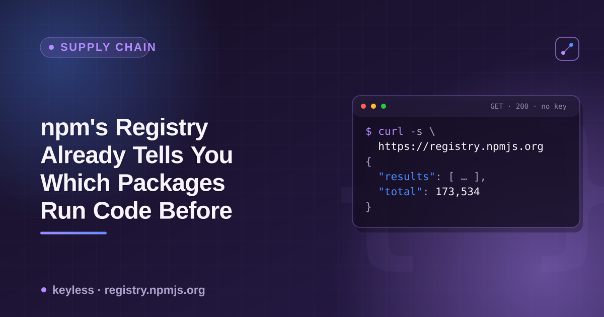

# npm, PyPI & crates.io install-time code execution — a cheatsheet



Installing a package can run arbitrary code before you've imported it, called a function, or read a line of its source — via npm's `preinstall`/`install`/`postinstall` lifecycle scripts, a PyPI package's `setup.py`/build backend, or a crates.io crate's `build.rs`. Only one of the three registries' own public metadata tells you this is coming. This is the reference: the exact field (or lack of one) per registry, a one-command check, and what changed in npm 12 (2026-07-08) about trusting that field by default.

## The three registries, side by side

| Registry | Can you see it before installing? | Field | Endpoint |
|---|---|---|---|
| npm | **Yes.** The full `package.json` `scripts` object — including `preinstall`/`install`/`postinstall` with their literal shell command — is served back in the registry's own JSON, no auth, no download. | `scripts.preinstall` / `scripts.install` / `scripts.postinstall` | `GET https://registry.npmjs.org/{name}/{version}` (or `/latest`) |
| PyPI | **No.** The JSON API only reflects declared metadata (classifiers, `requires_dist`, license, etc.) — it never parses or exposes a package's `setup.py` or build-backend code. A pure-metadata package and one with an aggressive custom build step look identical on this endpoint. | *(none)* | `GET https://pypi.org/pypi/{name}/json` |
| crates.io | **Partial, and only as a proxy signal.** The sparse index — what `cargo` itself fetches — has a `links` field (claims a native library name) and per-dependency `"kind": "build"` entries. Both strongly imply a `build.rs` exists. Neither is required for a crate to actually have one. | `links`, `deps[].kind == "build"` | `GET https://index.crates.io/{2}/{2}/{name}` (sparse index path; see note below) |

### Live-verified examples (2026-11-09)

```bash
# npm — scripts visible directly, before install
curl -s https://registry.npmjs.org/puppeteer/latest | jq '.scripts'
# { "unit": "wireit", ..., "postinstall": "node install.mjs" }

curl -s https://registry.npmjs.org/node-sass/latest | jq '.scripts.install, .scripts.postinstall'
# "node scripts/install.js"
# "node scripts/build.js"

curl -s https://registry.npmjs.org/left-pad/latest | jq '.scripts'
# { "test": "node test", "bench": "node perf/perf.js" }   <- no install-time hook

# PyPI — nothing comparable exists on this endpoint, for any package
curl -s https://pypi.org/pypi/pycurl/json | jq '.info | keys'
# 25 metadata keys, none of them a build-script or install-hook field

# crates.io sparse index path: index.crates.io/{first-2-chars}/{next-2-chars}/{name}
# (3-char names use a different shard layout; see crates.io's own docs)
curl -s https://index.crates.io/op/en/openssl-sys | tail -1 | jq '.links, [.deps[] | select(.kind=="build") | .name]'
# "openssl"
# ["bindgen","cc","openssl-src","pkg-config","vcpkg"]

curl -s https://index.crates.io/se/rd/serde | tail -1 | jq '.links'
# null   <- serde has no build script, and this correctly shows it

curl -s https://index.crates.io/li/bc/libc | tail -1 | jq '.links'
# null   <- libc DOES ship a build.rs; the index gives no signal for it at all
```

Sampled 21 popular npm packages against the `scripts` field. **7/21 (33%) carry an install-time hook**: `puppeteer`, `node-sass`, `cypress`, `esbuild`, `bcrypt`, `sqlite3`, `canvas`. The other 14 — `left-pad`, `lodash`, `chalk`, `express`, `react`, `axios`, `dotenv`, `uuid`, `debug`, `typescript`, plus (surprisingly) `sharp`, `electron`, `playwright` and `husky` — have none in their currently published version. `sharp` replaced its old postinstall binary download with per-platform `optionalDependencies` (`@img/sharp-linux-x64`, `@img/sharp-darwin-arm64`, etc.) — npm's own platform-matching resolves the right one, with zero code execution.

## What changed: npm 12 stopped trusting this field by default

For as long as the `scripts` field has existed, npm ran it automatically on install — the field was visible, but nothing enforced looking at it. That changed in **npm 12.0.0, released 2026-07-08** (confirmed from npm/cli's own changelog, not secondary coverage):

> "Dependency lifecycle scripts are now blocked by default unless allowed by the root package's `allowScripts` policy. After installing, run `npm install-scripts approve` to record approvals and `npm rebuild` to execute newly approved scripts."
> — [npm/cli CHANGELOG.md, v12.0.0](https://github.com/npm/cli/blob/latest/CHANGELOG.md)

Reproduced live in a throwaway project, npm@12.0.1:

```bash
$ npm install puppeteer --no-save
npm warn install-scripts 1 package had install scripts blocked because they are not covered by allowScripts:
npm warn install-scripts   puppeteer@25.16.0 (postinstall: node install.mjs)
npm warn install-scripts
npm warn install-scripts Run `npm install-scripts ls` to review, or `npm install-scripts approve <pkg>` to allow.

$ npm install-scripts ls
1 package has install scripts blocked because they are not covered by allowScripts:
  puppeteer@25.16.0 (postinstall: node install.mjs)

$ npm install chalk --no-save    # control: no lifecycle scripts, no warning at all
```

The same command under npm 10.x (pre-v12) runs the postinstall silently — no warning, no block. `npm install-scripts approve <pkg>` records an explicit per-package, per-version allowlist entry; upgrading the package means re-approving it.

## Why this matters now, not just structurally

**Shai-Hulud** is a real, self-propagating npm worm (first wave September 2025, later variants "Sha1-Hulud"/"Mini Shai-Hulud") that lived inside exactly this mechanism: a compromised package's own `postinstall` script. If the victim's machine held an npm token with publish rights, the worm used it to push itself into every other package that token could touch — no human operator on the other end required. Reported package counts vary by source (CISA: 500+; one tracker's indicator list: 526 versions; earlier reporting: 180+) but the propagation mechanism is consistent across every writeup. npm 12's default-block postpones that first silent execution until someone has explicitly reviewed and approved it.

## Check it yourself

```bash
#!/usr/bin/env bash
# has-install-scripts.sh <npm-package-name>
set -euo pipefail
pkg="$1"
curl -s "https://registry.npmjs.org/${pkg}/latest" \
  | python3 -c "
import json, sys
d = json.load(sys.stdin)
hooks = {k: v for k, v in d.get('scripts', {}).items() if k in ('preinstall', 'install', 'postinstall')}
if hooks:
    print(f'{d[\"name\"]}@{d[\"version\"]} runs code on install:')
    for k, v in hooks.items():
        print(f'  {k}: {v}')
else:
    print(f'{d[\"name\"]}@{d[\"version\"]}: no install-time lifecycle script')
"
```

## Honest limits

- PyPI has no equivalent field by design, not by omission — this reference can't tell you the npm-style answer for a PyPI package without downloading and reading its build backend yourself.
- crates.io's `links`/build-kind-dependency signal is real but incomplete (see `libc` above): absence of either does not prove a crate has no `build.rs`.
- `npm install-scripts ls`/`approve` are npm 12+ only. Projects still on npm 10/11 see none of this — the field was always readable via the registry API, but the CLI didn't act on it.

Promotes [`package-registry-scraper`](https://apify.com/ponderable_hydrometer/package-registry-scraper) (npm/PyPI/crates.io metadata, normalized) — the actor does not execute, install, or run scripts from any package; it only reads registry metadata, the same way this cheatsheet does. Paired dev.to piece, with the live npm 12 reproduction and the Shai-Hulud context: [*npm's Registry Already Tells You Which Packages Run Code Before You Install Them. PyPI's Doesn't.*](https://dev.to/ronin13/npms-registry-already-tells-you-which-packages-run-code-before-you-install-them-pypis-doesnt)
